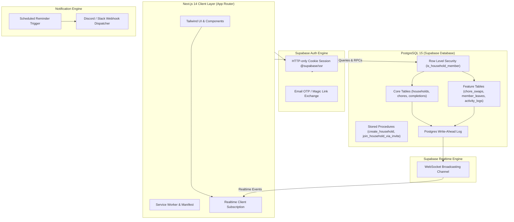
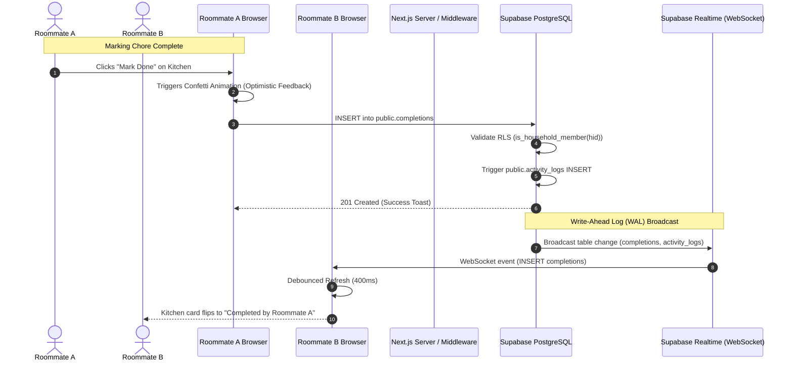
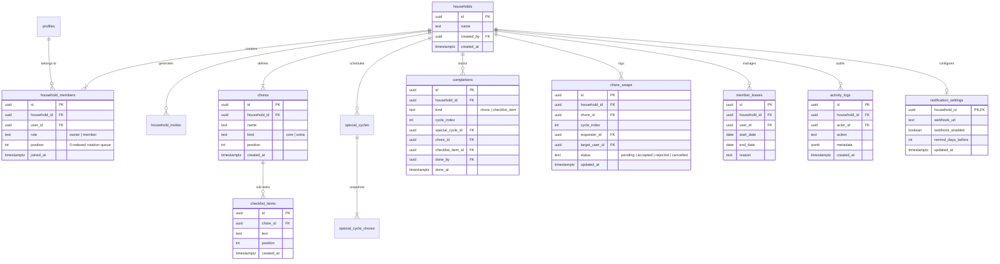
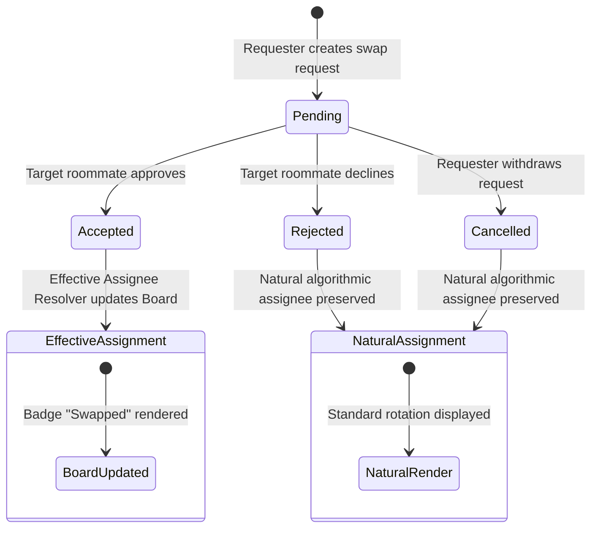
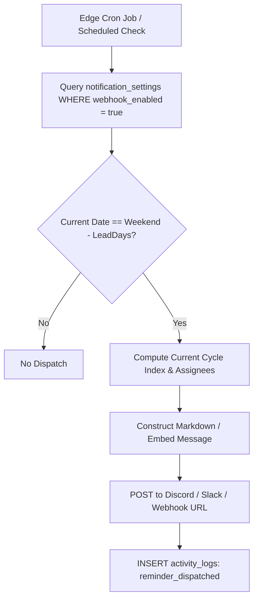

# Chore Divider — System Architecture & Technical Specification

## 1. Executive Summary & Core Invariants

Chore Divider is a multi-tenant household task scheduling platform designed to eliminate roommate friction around domestic duties. Unlike traditional task managers, Chore Divider relies on **deterministic mathematical rotation** rather than ad-hoc assignment or gamified point economies.

### Core System Invariants
1. **No Concurrent Core Overlap:** In a household with $\ge 3$ members, no member is ever assigned more than one of the 3 primary core chores (*Common Space*, *Kitchen*, *Bathroom*) during the same 14-day cycle.
2. **Complete Roster Cycling:** Across $N$ consecutive biweekly rounds (where $N = |Members|$), every member will cycle through every core chore exactly once.
3. **Strict Tenancy Isolation:** Row Level Security (RLS) policies at the PostgreSQL engine level enforce that no user can query or mutate household data outside their verified memberships.
4. **Deterministic Reproducibility:** Cycle assignments are calculated as pure functions of calendar time and roster position:
   $$\text{Assignee Index} = (Position_{chore} + CycleIndex) \pmod N$$

---

## 2. High-Level System Architecture

---

## 3. Data Flow & Real-Time Sync Pipeline

---

## 4. Entity Relationship Diagram (ERD)

---

## 5. Chore Trade & Swap State Machine

---

## 6. Automated Notification & Reminder Flow

---

## 7. Mathematical Rotation Algorithm Specification

### Parameters
* **Epoch Anchor ($T_0$):** Monday, October 5, 2026 (`2026-10-05T00:00:00.000Z`).
* **Cycle Duration ($\Delta$):** 14 standard calendar days (1,209,600,000 ms).
* **Roster ($M$):** Ordered sequence of member user IDs: $[m_0, m_1, \dots, m_{N-1}]$.

### Calculation
Given any UTC timestamp $T$:
$$\text{Days Elapsed} = \lfloor \frac{T - T_0}{86,400,000} \rfloor$$
$$\text{Cycle Index } (C) = \lfloor \frac{\text{Days Elapsed}}{14} \rfloor$$

Target cleaning weekend dates for cycle $C$:
$$\text{Saturday Date} = T_0 + (C \times 14) + 12 \text{ days}$$
$$\text{Sunday Date} = T_0 + (C \times 14) + 13 \text{ days}$$

For chore $k$ at zero-based queue position $P_k$:
$$\text{Natural Assignee Index} = (((P_k + C) \pmod N) + N) \pmod N$$
$$\text{Natural Assignee} = M[\text{Natural Assignee Index}]$$

### Swap Resolution Override
Let $S$ be the set of accepted swaps for cycle $C$.
$$\text{Effective Assignee} = 
\begin{cases} 
s.target\_user\_id & \text{if } \exists s \in S \text{ where } s.chore\_id = k \land s.status = \text{'accepted'} \\
\text{Natural Assignee} & \text{otherwise}
\end{cases}$$

---

## 8. Security & Row-Level Security (RLS) Verification Matrix

| Table | Operation | Policy Rule | Enforcing Predicate |
| :--- | :--- | :--- | :--- |
| `households` | SELECT | Members only | `is_household_member(id)` |
| `household_members` | SELECT | Co-members only | `is_household_member(household_id)` |
| `chores` | ALL | Members only | `is_household_member(household_id)` |
| `completions` | ALL | Members only | `is_household_member(household_id)` |
| `chore_swaps` | ALL | Members only | `is_household_member(household_id)` |
| `member_leaves` | ALL | Members only | `is_household_member(household_id)` |
| `activity_logs` | SELECT / INSERT | Members only | `is_household_member(household_id)` |
| `notification_settings` | ALL | Members only | `is_household_member(household_id)` |
